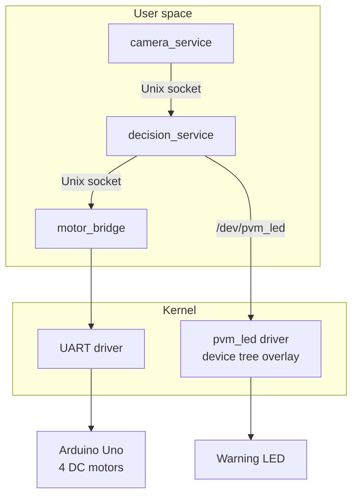

# rpi-embedded-linux-robot

Embedded Linux stack for an obstacle-avoidance robot on a Raspberry Pi 4B (ARM),
built on top of my graduation capstone. It goes from the hardware up:
a kernel driver for a warning LED declared through a device tree overlay,
then user-space C++ services that talk to each other over Linux IPC.

> Status: work in progress. See Roadmap.

## Architecture



## Repository layout
| Path | What |
|---|---|
| `kernel/hello` | First out-of-tree module |
| `kernel/pvm_chardev` | Character device driver (`/dev/pvm`), no hardware |
| `kernel/pvm_led` | Platform driver for the warning LED + device tree overlay |
| `tools/gpio_regs` | Drives the LED by writing BCM2711 GPIO registers from user space |
| `tools/chardev_test` | User-space test for `/dev/pvm` |
| `services/*` | Middleware services (camera, decision, motor bridge) |
| `docs/datasheet-notes.md` | Register values I looked up in the BCM2711 datasheet |

## Build
```bash
# user-space tools and services
sudo apt install build-essential cmake git gdb valgrind device-tree-compiler
./scripts/run.sh

# kernel modules (on the Pi, needs kernel headers)
cd kernel/hello && make
```

## Results
| Metric | Value |
|---|---|
| LED latency from obstacle event to GPIO toggle | TODO |
| End-to-end latency (capture → UART), mean / max | TODO |

## Problems I hit and how I fixed them
- TODO

## Roadmap
- [ ] Hello kernel module
- [ ] Character device driver + user-space test (GDB, Valgrind)
- [ ] GPIO via direct register access (BCM2711 datasheet)
- [ ] LED platform driver + device tree overlay
- [ ] Custom kernel build with menuconfig
- [ ] Middleware: IPC between services
- [ ] Middleware: multi-threaded pipeline
- [ ] Decision service drives the LED through the driver
- [ ] Unit tests, latency measurement
